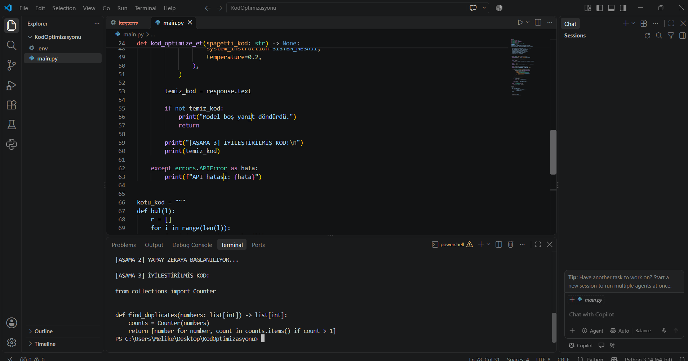

# Yapay Zeka Destekli Kod İyileştirme ve Optimizasyon

Python kodunu Gemini API'ye göndererek anlamlı değişken isimleri, tip belirteçleri ve daha verimli bir algoritma ile yeniden düzenlenmesini isteyen ders çalışması.

## Çalıştırma

1. `py -m pip install -r requirements.txt` komutuyla paketleri kurun.
2. Proje klasöründe `.env` dosyası oluşturun ve kendi anahtarınızı `GEMINI_API_KEY=anahtariniz` şeklinde yazın. Bu dosyayı GitHub'a yüklemeyin.
3. `py main.py` komutunu çalıştırın.

Örnek girdi, tekrar eden tam sayıları ilk görünme sırasıyla ve birer kez döndürür. Model yanıtı terminale yazdırılır; otomatik çalıştırılmaz. Yanıt her istekte farklı olabilir. API yoğunluğunda 503 hatası alınabilir.

## Başarılı çalıştırma çıktısı

